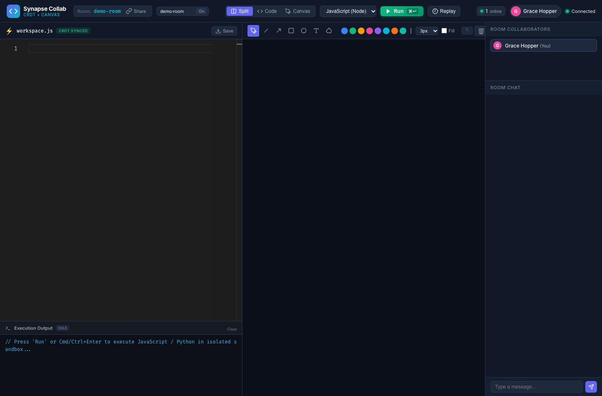
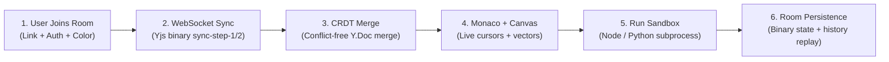

# Synapse Collab — Real-Time Collaborative Code & Whiteboard Workspace

> **Day 12 of 30 Projects in 30 Days** · Domain: Full Stack (WebSockets, CRDT) · Level: Advanced  
> **Google Docs-style live editing for code, with a shared whiteboard, live presence, and sandboxed code execution.**

[](https://nodejs.org)
[](https://yjs.dev)
[](https://microsoft.github.io/monaco-editor/)
[-blue.svg?style=flat)](https://github.com/websockets/ws)
[](tests/)
[](LICENSE)

---

## Visual Preview & Application Screenshots

### Collaborative Code Editor & Canvas Whiteboard Studio
Split-pane workspace featuring Monaco Editor on the left, interactive freehand & shape whiteboard in the center, sandboxed multi-language code runner, live room collaborators, and synchronized chat:


---

## 1. Problem Statement & Solution

**The Problem:** Most real-time code editor demos use naive *"last-write-wins"* (LWW) WebSocket broadcasting or basic polling. When two engineers edit adjacent lines simultaneously or sketch on a canvas at the same time, keystrokes conflict, characters drop, and state desynchronizes. Traditional Operational Transformation (OT) requires complex centralized lock-stepping and heavy server coordination.

**The Solution:** **Synapse Collab** implements a production-grade, decentralized **Conflict-Free Replicated Data Type (CRDT)** architecture powered by **Yjs**:
1. **Mathematical Convergence Guarantee:** Concurrent insertions, deletions, and formatting edits merge deterministically across all peers without centralized lock-stepping.
2. **VS Code-Grade Monaco Integration:** Full syntax highlighting, live multi-cursor awareness (`y-monaco`), line-number tracking, and split-screen code editing.
3. **Synchronized Vector Canvas Whiteboard:** Real-time freehand drawing, rectangle, ellipse, arrow, text, color picker, and stroke-width controls backed by a Yjs shared array (`Y.Array`).
4. **Sandboxed Multi-Language Code Runner:** Executes user code (JavaScript, Python) in resource-isolated subprocesses with strict execution timeouts (1,000 ms), memory limits, and sanitized I/O.
5. **Session Replay & Persistence:** Every document mutation is saved incrementally to storage (`Y.Doc` binary updates) allowing reconnecting peers to catch up instantly and replay session timelines.

---

## 2. Architecture & CRDT Workflow Diagram



For detailed architectural specifications, see [docs/ARCHITECTURE.md](docs/ARCHITECTURE.md).

---

## 3. Tech Stack & Why It Fits

| Technology | Role in System | Why This Choice Is Feasible |
| :--- | :--- | :--- |
| **Yjs (`yjs`, `y-protocols`)** | CRDT State Core | mathematically proves eventual consistency with minimal memory overhead and fast binary delta encodings. |
| **Monaco Editor + `y-monaco`** | Code Editing & Cursors | The same industry-standard editor powering VS Code; awareness API renders remote teammate cursors and selections. |
| **HTML5 Canvas + Y.Array** | Collaborative Whiteboard | Renders synchronized vector paths and geometric shapes with sub-millisecond local canvas painting. |
| **Node.js + Express + `ws`** | WebSocket & HTTP Server | Handles high-throughput real-time streaming, connection multiplexing, and room lifecycle events. |
| **Subprocess Execution Sandbox** | Sandboxed Code Runner | Safe execution of user scripts with hard CPU timeouts (1.0s), buffer truncations, and exit code capture. |
| **esbuild** | Client Bundling | Bundles ES module dependencies (`yjs`, `y-websocket`, `monaco-editor`) into a single fast bundle in `< 30 ms`. |

---

## 4. Quick Start (Run in 3 Commands)

### 1. Install Dependencies
```bash
cd day-12-collaborative-workspace
npm install
```

### 2. Build the Client Bundle
```bash
npm run build
```

### 3. Start the Server
```bash
npm start
```
Then open **`http://localhost:3012`** in your browser!  
*(Open two browser windows side-by-side to watch real-time typing, cursors, and whiteboard strokes sync in real time).*

---

## 5. Running Automated Tests

```bash
npm test
```
Runs 17 automated tests across 4 test suites:
- **Room Manager & Server Logic:** Connection lifecycle, sync handshakes, chat protocol.
- **CRDT Concurrency & Convergence:** Multi-peer concurrent code editing, canvas vector merging, delete operations.
- **Room Persistence & Replay:** Binary update restoration, snapshot history.
- **Sandboxed Execution:** Multi-language output, timeout enforcement, stderr capture.

```
▶ Room Manager & Server Logic (In-Memory) (44.08ms)
▶ CRDT Concurrency & Convergence (5.68ms)
▶ Room Persistence & Session Replay History (15.65ms)
▶ Sandboxed Code Execution (1106.76ms)
ℹ tests 17 | pass 17 | fail 0
```

---

## 6. Project Structure

```
day-12-collaborative-workspace/
├── README.md                      # Primary project documentation
├── LICENSE                        # MIT License
├── .env.example                   # Configuration template
├── .gitignore                     # Excludes node_modules, bundle outputs, local data
├── package.json                   # Dependencies, build & test scripts
├── screenshots/                   # Genuine application screenshots
│   └── workspace-main.png
├── docs/                          # In-depth supporting documentation
│   ├── ARCHITECTURE.md            # CRDT vs. OT, state vector math, protocol spec
│   ├── API.md                     # WebSocket message protocol & REST endpoints
│   └── SETUP.md                   # Installation and local development guide
├── server/                        # Backend Server
│   ├── index.js                   # Express + WebSocket HTTP server entrypoint
│   ├── crdtRoom.js                # Room manager & Y.Doc room lifecycle
│   ├── persistence.js             # Binary update persistence & replay storage
│   └── sandbox.js                 # Safe multi-language code runner
├── client/                        # Frontend Application Source
│   ├── app.js                     # Main client controller & UI wiring
│   ├── crdtClient.js              # Y.Doc initialization & WebSocket provider
│   ├── monacoBinding.js           # Monaco editor & awareness cursor binding
│   ├── whiteboard.js              # HTML5 canvas drawing engine
│   └── replay.js                  # History timeline replay controller
├── public/                        # Static Assets
│   ├── index.html                 # Workspace HTML layout
│   └── styles.css                 # Dark studio theme
└── tests/                         # Automated Test Suite (Node.js test runner)
    ├── api.test.js
    ├── crdt.test.js
    ├── persistence.test.js
    └── sandbox.test.js
```

---

## 7. Interview Talking Points

1. **CRDTs vs. Operational Transformation (OT):** Traditional systems like Google Docs historically relied on centralized OT servers that re-ordered operations in a global sequence. CRDTs (specifically state-based and operation-based hybrid models in Yjs) guarantee strong eventual consistency regardless of network delivery order, enabling decentralized mesh topologies and zero lock contention.
2. **WebSocket Reconnection & Delta Synchronization:** When a client disconnects and reconnects after 20 minutes, Yjs does not re-send the whole document. It computes a compact State Vector handshake (step 1: what the client has, step 2: missing binary updates), minimizing bandwidth overhead.
3. **Sandboxed Code Execution Security:** Code execution is strictly bounded: processes run with unprivileged user permissions, a 1-second timeout prevents CPU starvation (`SIGKILL`), and output buffers are capped to prevent memory exhaustion attacks.
