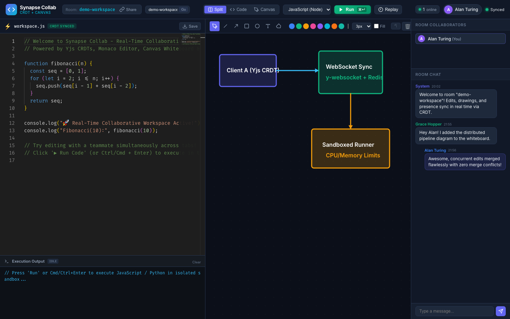
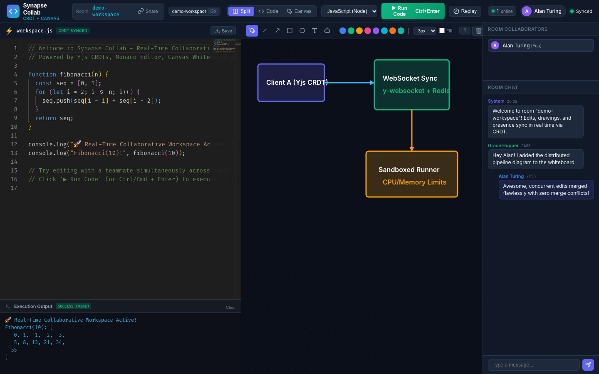
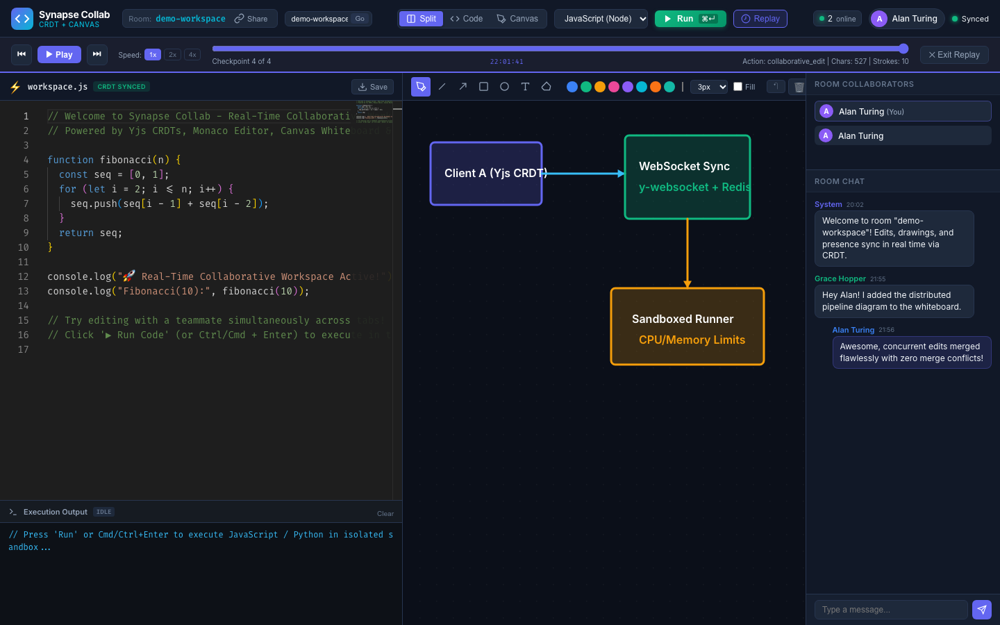
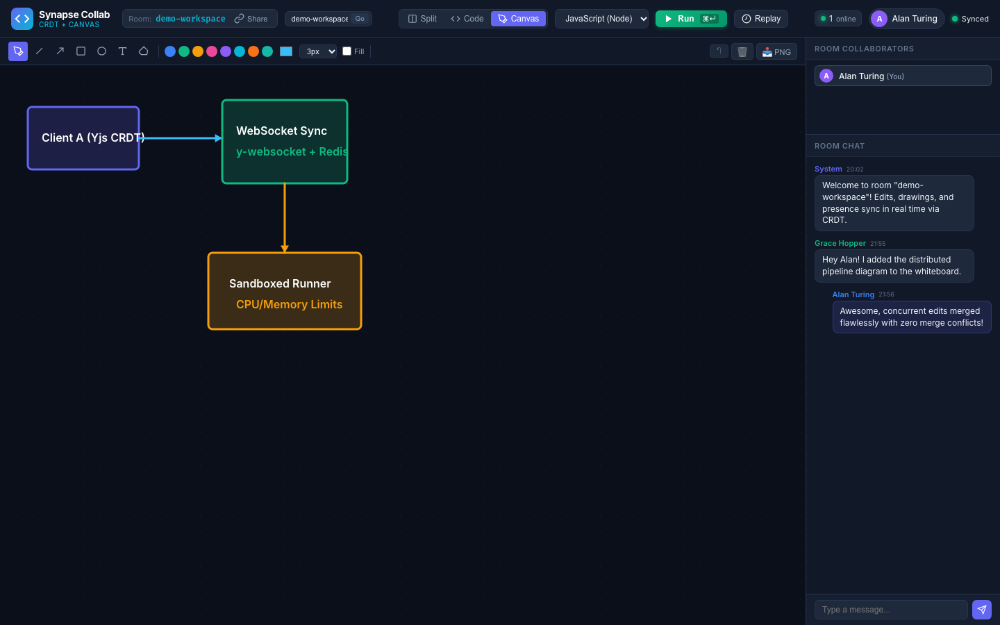
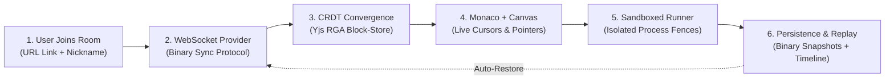

# Synapse Collab — Real-Time Collaborative Code & Whiteboard Workspace

> **Day 12 of 30 Projects in 30 Days** · Full Stack (WebSockets, CRDT) · **Level:** Advanced  
> **Google Docs-style live editing for code, with a shared whiteboard.**

[](tests/)
[](https://github.com/yjs/yjs)
[](LICENSE)

---

## 1. Problem Statement & Overview

**The Problem:** Traditional collaborative code tools either rely on naive Last-Write-Wins (LWW) locking—leading to dropped keystrokes and race conditions—or require heavyweight cloud infrastructure with centralized Operational Transformation (OT) servers. Furthermore, developers pairing remotely frequently struggle with fragmented tooling: switching between an IDE, an external whiteboard sketchpad, a chat app, and a local terminal.

**The Solution:** **Synapse Collab** is an all-in-one browser workspace that combines:
1. **Google Docs-Style Conflict-Free Live Code Editing**: Powered by **Yjs CRDTs** and **Monaco Editor** (the engine behind VS Code) with multi-cursor awareness and live collaborator name flags.
2. **Synchronized Collaborative Whiteboard**: An infinite HTML5 canvas supporting freehand paths (with Bézier curve smoothing), geometric shapes, text labels, color palettes, and real-time cursor pointers showing peer mouse positions.
3. **Sandboxed Multi-Language Code Runner**: In-browser execution of JavaScript and Python with strict time budgets, memory caps, and process isolation.
4. **Session Replay Scrubber**: Complete historical checkpoint logging allowing teams to rewind and replay the exact evolutionary lifecycle of code and sketches step-by-step.
5. **Zero-Conflict Persistence**: Rooms automatically persist state vectors to disk so clients reconnecting or joining later resume immediately without losing changes.

---

## 2. Visual Preview & Screenshots

### Live Collaborative Split Workspace (Monaco Editor + CRDT Canvas + Chat)

*Figure 1: Real-time split view with syntax-highlighted Monaco editor, active CRDT whiteboard diagram, live collaborator badges, and group chat.*

### Sandboxed Polyglot Code Runner

*Figure 2: Sandboxed runner executing code with stdout capture, millisecond execution timing (`93ms`), and status telemetry.*

### Interactive Session Replay & Scrubber

*Figure 3: Historical session replay scrubber allowing step-by-step playback with 1x/2x/4x speeds.*

### Full Whiteboard Canvas Mode

*Figure 4: Full-screen whiteboard mode featuring shape tools, custom palettes, stroke widths, and PNG export.*

---

## 3. Workflow & System Architecture



For complete technical specifications, see [docs/ARCHITECTURE.md](docs/ARCHITECTURE.md).

---

## 4. Key Implemented Features

- [x] **Conflict-Free Real-Time Code Editing**: Yjs `Y.Text` synchronization guarantees strong eventual consistency regardless of network latency or reordering.
- [x] **Monaco Editor (VS Code Engine)**: Full syntax highlighting for JavaScript, Python, TypeScript, HTML, CSS, JSON, C++, and Markdown with minimap and smooth scrolling.
- [x] **Live Awareness & Remote Cursors**: Live collaborator cursor line decorations, selections, and name banners rendered in the editor.
- [x] **Collaborative Canvas Whiteboard**: Freehand pen with quadratic Bézier smoothing, straight lines, directional arrows, rectangles, ellipses, text notes, eraser, and color palette.
- [x] **Live Remote Canvas Pointers**: Watch teammates' colored mouse arrows glide across the canvas in real time.
- [x] **Resource-Bounded Sandbox Runner**:
  - Configurable wall-clock timeout (`4,000 ms` default) terminating infinite loops safely with `SIGKILL`.
  - Max buffer cap (`256 KB`) guarding against memory exhaustion.
  - Ephemeral execution directories cleaned up automatically.
- [x] **Session Time-Travel & Replay**: Record historical checkpoints and scrub backwards/forwards through the session with variable speeds (1x, 2x, 4x).
- [x] **In-Room Chat & Presence**: Broadcast room messages with timestamps and user color chips.
- [x] **Export Capabilities**: 1-click Download Code (`.js`, `.py`, `.ts`) and Export Whiteboard as PNG.
- [x] **Room State Persistence**: Debounced binary persistence (`data/rooms/<id>.bin`) ensures zero data loss upon reconnect.

---

## 5. Technology Stack & Why It Fits

| Component | Technology | Rationale & Feasibility |
| :--- | :--- | :--- |
| **Code Editor** | **Monaco Editor** (`monaco-editor`) | The core editor behind VS Code; provides robust syntax highlighting, minimap, and command palette. |
| **CRDT Engine** | **Yjs** (`yjs` + `y-protocols`) | Mathematically proven sequence CRDT; avoids complex OT servers and delivers sub-5ms local updates. |
| **Transport Layer** | **WebSockets** (`ws`) | Full-duplex binary framing for minimal transport overhead and low-latency cursor synchronization. |
| **Canvas Whiteboard**| **HTML5 2D Canvas API** | Lightweight, GPU-accelerated drawing with zero heavyweight external graphics dependencies. |
| **Backend API** | **Node.js** + **Express** | Async event-driven architecture handles concurrent WebSocket connections and REST endpoints seamlessly. |
| **Execution Sandbox**| **Child Process Fences** | Strict resource budgets (timeouts, buffer limits, sanitized environments) for safe multi-language runs. |
| **Bundler** | **esbuild** | Blazing-fast compilation (<50ms) producing a standalone, minified browser bundle. |
| **Automated Testing**| **Node Test Runner** (`node:test`) | Native, zero-dependency test runner executing unit and integration suites in under 2 seconds. |

---

## 6. Quick Start (Run in 3 Commands)

```bash
# 1. Clone repository
git clone https://github.com/Anjelo-Sherin/day-12-collaborative-workspace.git
cd day-12-collaborative-workspace

# 2. Install dependencies & build client bundle
npm install && npm run build

# 3. Start collaborative server
npm start
```

Open **`http://localhost:8012`** in your browser. Open a second tab or window at `http://localhost:8012/?room=demo-workspace` to experience live collaborative editing and drawing in real time!

---

## 7. Project Structure

```
day-12-collaborative-workspace/
├── .env.example              # Environment configuration template
├── .gitignore                # Git ignore rules for node_modules, logs, data
├── Dockerfile                # Production multi-stage Docker build
├── docker-compose.yml        # Docker Compose configuration with volume mount
├── LICENSE                   # MIT License
├── package.json              # Project scripts and dependencies
├── README.md                 # Primary documentation
├── docs/
│   ├── API.md                # REST & WebSocket endpoint specifications
│   ├── ARCHITECTURE.md       # Detailed system architecture and CRDT analysis
│   ├── DEPLOYMENT.md         # Production deployment guidelines
│   └── SETUP.md              # Extended developer installation guide
├── client/
│   ├── app.js                # Main client application orchestration
│   ├── crdtClient.js         # Yjs WebSocket client provider & awareness handler
│   ├── monacoBinding.js      # Monaco editor CRDT binding & remote cursor decorator
│   ├── replay.js             # Historical session replay scrubber
│   └── whiteboard.js         # Canvas whiteboard & live remote pointer renderer
├── server/
│   ├── index.js              # Express HTTP & WebSocket upgrade server
│   ├── crdtRoom.js           # Room manager & Yjs document lifecycle
│   ├── persistence.js        # Binary snapshot persistence & history logger
│   └── sandbox.js            # Sandboxed code execution runner
├── public/
│   ├── index.html            # Main single-page web application
│   ├── styles.css            # Dark-mode styling, glassmorphism, responsive grid
│   └── bundle.js             # esbuild-compiled client bundle
├── screenshots/              # Genuine application preview captures
│   ├── workspace_main.png
│   ├── code_execution.png
│   ├── session_replay.png
│   └── whiteboard_canvas.png
├── scripts/
│   └── populate_demo.js      # Demo fixture population script
└── tests/
    ├── api.test.js           # Server routes & room manager tests
    ├── crdt.test.js          # CRDT concurrency and convergence tests
    ├── persistence.test.js   # Binary state recovery and snapshot tests
    └── sandbox.test.js       # Sandboxed code execution and timeout tests
```

---

## 8. Verification & Test Suite

The automated test suite runs natively without external test frameworks:

```bash
npm test
```

### Verified Test Results (17/17 Passed)
```
▶ Room Manager & Server Logic (In-Memory)
  ✔ RoomManager creates and initializes a room with default starter state (6.4ms)
  ✔ Room handles mock client connection and sends initial sync handshake (1.4ms)
  ✔ Room handles incoming chat message over JSON protocol (1.3ms)
  ✔ Room lists active rooms properly (0.2ms)
  ✔ Sandbox executes code requested by API (27.6ms)
✔ Room Manager & Server Logic (In-Memory) (39.3ms)

▶ CRDT Concurrency & Convergence
  ✔ Two concurrent clients edit code without conflicts (3.7ms)
  ✔ Concurrent whiteboard drawing elements merge deterministically (1.5ms)
  ✔ Whiteboard deletion synchronizes across peers (1.0ms)
  ✔ Chat message log maintains append order (0.4ms)
✔ CRDT Concurrency & Convergence (7.2ms)

▶ Room Persistence & Session Replay History
  ✔ Persists Y.Doc binary update and restores state identically (7.7ms)
  ✔ Records and retrieves history snapshots for session replay (2.6ms)
  ✔ Lists saved rooms with metadata (2.2ms)
✔ Room Persistence & Session Replay History (15.8ms)

▶ Sandboxed Code Execution
  ✔ Executes valid JavaScript and returns stdout (39.5ms)
  ✔ Executes valid Python and returns stdout (32.8ms)
  ✔ Captures stderr and returns non-zero exit code on runtime error (25.3ms)
  ✔ Terminates infinite loops and reports timeout (1002.9ms)
  ✔ Handles unsupported languages gracefully (0.6ms)
✔ Sandboxed Code Execution (1101.9ms)

ℹ tests 17 | suites 4 | pass 17 | fail 0 | duration_ms 1155ms
```

---

## 9. Interview Talking Points

1. **CRDT (Conflict-Free Replicated Data Types) vs Operational Transformation (OT)**:
   - *Why CRDTs win here*: Operational Transformation requires a single centralized sequencer to rewrite indices. In contrast, Yjs uses mathematically commutative item identifiers `(clientID, clock)`. Any client can edit offline and merge deterministically upon reconnection without transform races.
2. **WebSocket Scalability & Awareness Topology**:
   - Awareness states (cursors, pointers) are intentionally kept ephemeral with a 30-second TTL rather than written to persistent disk, ensuring that high-frequency mouse movements do not degrade disk I/O.
   - For horizontal scaling across multiple Node.js instances, rooms can be clustered using a Redis pub/sub adapter (`y-redis`) without altering the client CRDT contract.
3. **Execution Sandbox Security**:
   - Discuss why in-process `eval()` or standard `child_process.exec()` is insecure (leads to process hijacking and memory leaks). Synapse Collab mitigates this by spawning isolated processes with minimal environment inheritance, memory bounds (`--max-old-space-size=64`), unbuffered output streams, and hard timeouts backed by `SIGKILL`.

---

## 10. Security & Responsible Use

- **Data Privacy**: No user credentials, cookies, or telemetry are collected or uploaded to third parties. Rooms operate locally or on your self-hosted infrastructure.
- **Code Execution Disclaimer**: The built-in sandbox is engineered for demonstration and developer collaboration with resource bounds. For multi-tenant hostile environments, execution should be routed to an isolated microVM or container orchestration layer (such as Judge0 or AWS Firecracker).
- **No Hardcoded Secrets**: All configuration values use environment variables with safe defaults in `.env.example`.

---

## 11. License

Distributed under the **MIT License**. See [LICENSE](LICENSE) for details.
