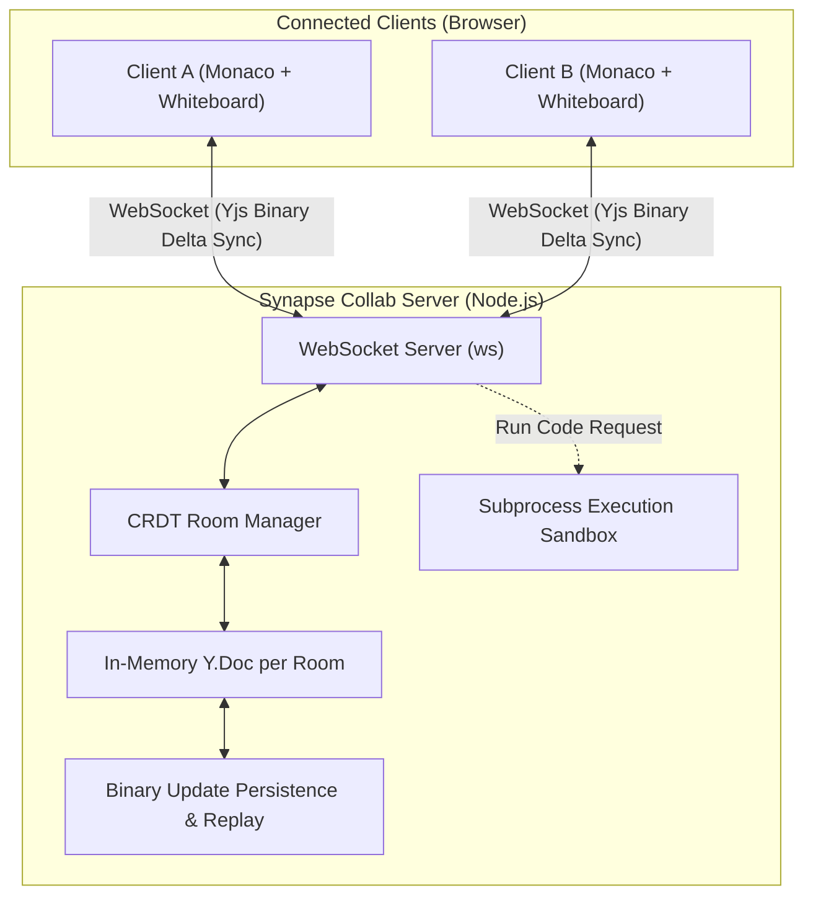

# Architecture Specification — Synapse Collab

## Overview

Synapse Collab is a real-time collaborative workspace supporting synchronous multi-user code editing, collaborative whiteboard sketching, chat, user presence awareness, and sandboxed code execution.

The architecture is built around **Conflict-Free Replicated Data Types (CRDTs)** via the **Yjs** library, enabling decentralization, peer-to-peer convergence, and network resilience.

---

## CRDT vs. Operational Transformation (OT)

| Dimension | Operational Transformation (OT) | Yjs CRDT (Synapse Collab) |
| :--- | :--- | :--- |
| **Centralization** | Strict central authority required to sequence operations | Decentralized / Peer-to-Peer capable; server acts as a relay |
| **Complexity** | Exponentially complex transformation functions (TP2 property) | Mathematical convergence baked into underlying data structure |
| **Offline Editing** | Prone to desync when replaying long divergence logs | Effortless merging of divergent branches via state vectors |
| **Network Efficiency** | Verbose JSON operations | Highly optimized binary delta encodings (Lib0 / Yjs encoding) |

---

## Core Components

### 1. Client Architecture
- **State Layer (`client/crdtClient.js`):** Hosts the local `Y.Doc` instance, binds to WebSocket transport, and tracks local client ID.
- **Monaco Binding (`client/monacoBinding.js`):** Couples Monaco editor buffer changes with the shared `Y.Text('monaco')` type and remote awareness cursors (`y-protocols/awareness`).
- **Whiteboard Engine (`client/whiteboard.js`):** Couples HTML5 Canvas drawing with a shared `Y.Array('whiteboard')` containing stroke and shape vectors.
- **Session Replay Controller (`client/replay.js`):** Enables timeline navigation across document updates.

### 2. Server Architecture
- **WebSocket Server (`server/index.js`):** Routes incoming connections to their respective rooms (`/ws?room=<roomId>`).
- **Room Manager (`server/crdtRoom.js`):** Manages active rooms, tracks connected sockets, broadcasts awareness and document updates.
- **Persistence (`server/persistence.js`):** Saves Yjs binary update chunks to disk (`data/<roomId>.updates`) and produces snapshots for history replay.
- **Execution Sandbox (`server/sandbox.js`):** Spawns child processes (`node`, `python3`) with hard resource and time constraints (1000ms max CPU time).

---

## State Synchronization Protocol

1. **Connection Handshake:**
   - Client sends SyncStep 1 (State Vector of its local `Y.Doc`).
   - Server responds with SyncStep 2 (Binary updates needed by the client).
   - Server sends SyncStep 1 (State Vector of the server's `Y.Doc`).
   - Client responds with SyncStep 2 (Binary updates needed by the server).
2. **Incremental Updates:**
   - Any local modification produces an incremental update encoded into a compact binary buffer.
   - The buffer is transmitted via WebSocket and applied using `Y.applyUpdate(doc, update)`.
3. **Awareness & Presence:**
   - User identity, color, mouse position, and code selection ranges are broadcast through the lightweight awareness protocol without bloating document history.
