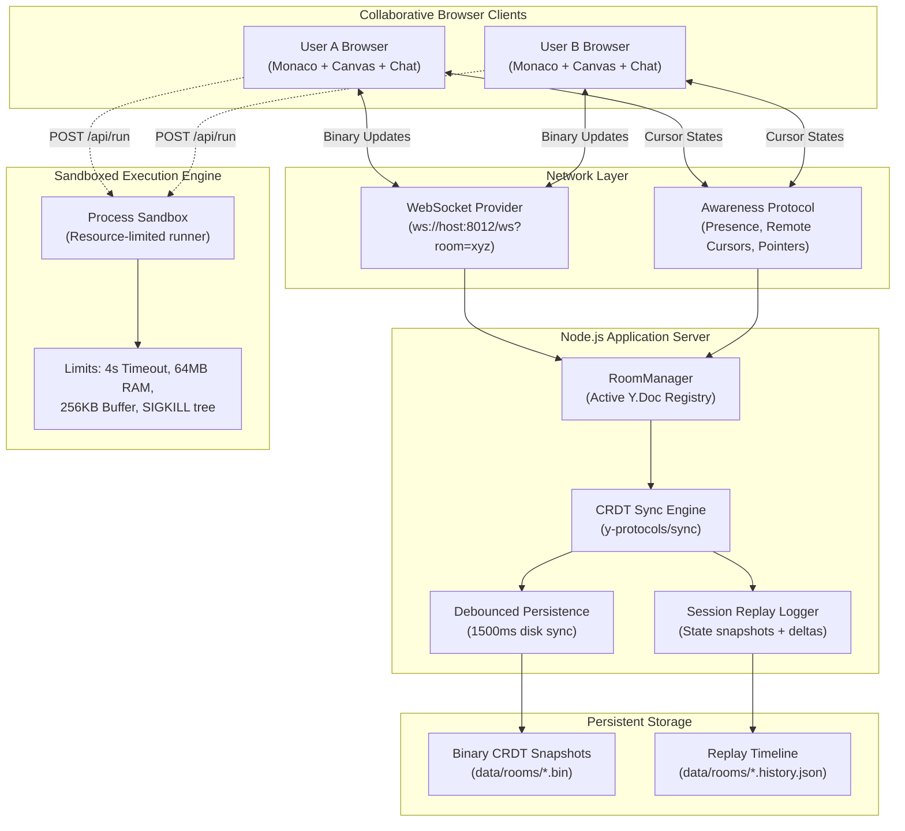

# System Architecture — Synapse Collab

## 1. High-Level Architectural Overview

Synapse Collab is built upon a decentralized Conflict-Free Replicated Data Type (CRDT) foundation utilizing **Yjs**, synchronized through full-duplex WebSockets with stateful room persistence and an isolated process sandbox for code execution.

---

## 2. CRDT Convergence Engine

### Why CRDT (Yjs) over Operational Transformation (OT)
- **Centralized Dependency Elimination**: Traditional Google Docs architecture uses Operational Transformation (OT), requiring a single authoritative central server to sequence and transform operation indices against concurrent commits.
- **Mathematical Convergence**: Yjs implements a sequence CRDT based on a block-store structure where characters are represented as unique items with `(clientID, clock)` coordinates. Edits commute deterministically; regardless of network latency, packet reordering, or temporary disconnection, all peers reach identical states once updates exchange completes.
- **Binary Delta Efficiency**: Yjs encodes state vectors and incremental structural updates in compact binary representation using Variable-Length Unsigned Integers (`varUint`) via `lib0/encoding`. Updates require orders of magnitude fewer bytes than JSON AST transformations.

---

## 3. Collaborative Data Structures

Within each room's root `Y.Doc`:

| Structure Name | Yjs Type | Purpose | Concurrency Strategy |
| :--- | :--- | :--- | :--- |
| `monaco` | `Y.Text` | Source code in the collaborative editor | RGA sequence CRDT; characters commute deterministically |
| `whiteboard` | `Y.Array` | Visual drawing elements (paths, rectangles, circles, arrows, text notes) | Ordered array CRDT; elements are keyed by unique IDs with author attribution |
| `chat` | `Y.Array` | Room group messaging stream | Append-only CRDT log; sorted by logical clock and client timestamps |
| `awareness` | `Awareness` | Non-persistent ephemeral state (remote cursors, live canvas pointers, user badges) | Timed TTL ephemeral protocol; auto-expires after 30 seconds of inactivity |

---

## 4. Sandboxed Code Execution Architecture

Code execution occurs inside isolated operating system subprocesses with strict resource fences:

1. **Isolation**: Code is generated into a unique, ephemeral execution directory under the system temporary path (`/tmp/collab-run-<id>/`) with restricted file system permissions.
2. **Environment Scrubbing**: Sensitive environment variables (e.g. system credentials, token environments) are stripped. Only `PATH`, `LANG`, and localized execution variables are passed.
3. **Execution Guards**:
   - **Wall-Clock Time Budget**: Hard execution timer (default: `4,000 ms`, max: `10,000 ms`). If execution exceeds the threshold, the process receives `SIGKILL` to prevent infinite loop resource exhaustion.
   - **Memory Cap**: Node.js executions are bounded by `--max-old-space-size=64`.
   - **Output Truncation**: Standard output and error streams are capped at `256 KB` to avoid buffer exhaustion attacks.
4. **Cleanup Guarantee**: The ephemeral workspace directory is recursively removed in `finally` blocks regardless of normal completion, error, or kill signals.

---

## 5. Persistence and Session Replay Pipeline

- **Debounced Snapshot Storage**: To prevent disk I/O thrashing during burst typing (e.g. 100+ keystrokes/minute), room states are debounced at 1,500 ms intervals before writing binary `Uint8Array` state vectors to disk (`data/rooms/<roomId>.bin`).
- **History Timeline Scrubber**: Document updates are periodically sampled (5,000 ms interval during active edits) into incremental historical checkpoints (`data/rooms/<roomId>.history.json`). Each checkpoint stores a base64-encoded full state vector, enabling the client's Replay Player to scrub backwards and forwards through any point in the room's development lifecycle.
